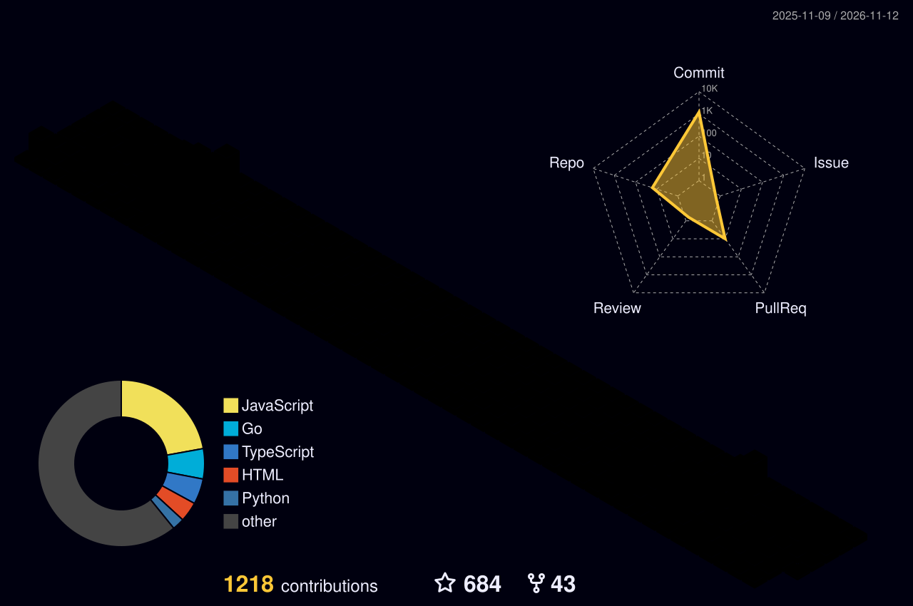

<h1> Hey! Nice to see you.</h1>

<picture>
  <source media="(prefers-color-scheme: dark)" srcset="./profile-3d-contrib/profile-night-rainbow.svg" />
  <source media="(prefers-color-scheme: light)" srcset="./profile-3d-contrib/profile-gitblock.svg" />
  
</picture>

<!-- LANGUAGE_STATS_START -->
### Top Languages

<!-- LANGUAGE_STATS_END -->

